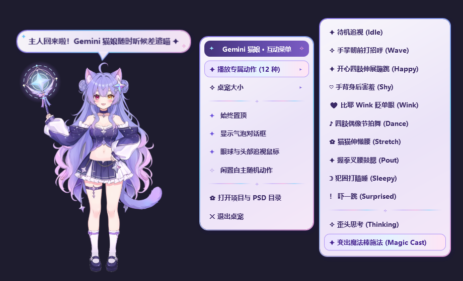
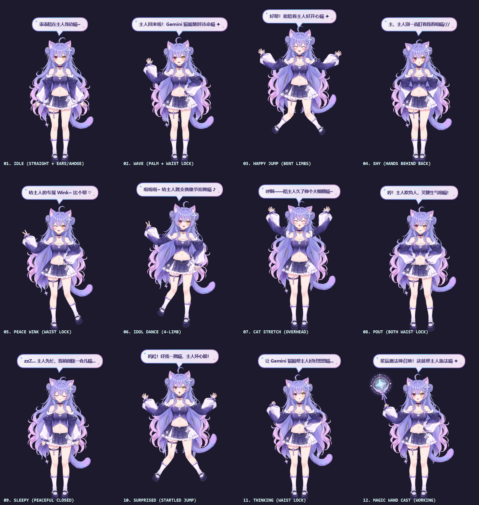
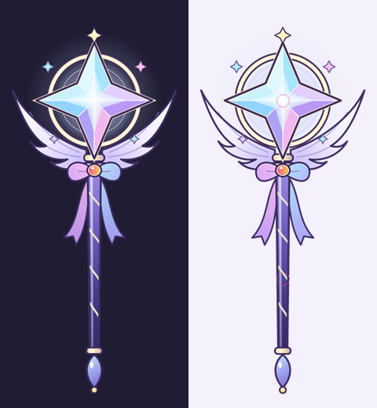

# Antigravity Gemini Catgirl Live2D Desktop Pet

<p align="center">
  <b>轻量化原生 C# WPF 3D ArtMesh Live2D 猫娘桌宠 · 专为 Antigravity 打造的伴生式桌面伙伴</b><br/>
  <sub>Zero-dependency native Windows desktop pet (~110 KB) with 23-layer AI PSD decomposition, 60 FPS GPU mesh deformation, articulated limbs, custom magic wand casting & real-time Antigravity Hooks sync.</sub>
</p>

<p align="center">
  
</p>

---

## ✨ 核心特性 (Features)

- **⚡ 极致轻量、原生零依赖**：纯 C# + WPF `Viewport3D` GPU 加速网格变形，直接使用 Windows 自带 `.NET Framework 4.0` 编译，无需 Visual Studio、无需 Node/Electron、无需 NuGet 包，核心程序仅 **~110 KB**。
- **🎨 真·Live2D 级 23 层拆解与独立四肢骨骼**：
  - 角色立绘经 SIGGRAPH See-through 分层拆解为完整 PSD（含后发、前发、呆毛、双猫耳、双眼白/虹膜/睫毛、脸颊、裙摆、双腿、双袖、猫尾等），并内置 4 套独立手部手型（自然垂手、正面张掌、比耶 V 手、握拳猫爪）。
  - **三重锁定眼球防溢出**：硬矢量椭圆裁剪 + `OpacityMask` + 非对称眼眶边界限幅，任意角度追视鼠标绝不穿模。
  - **防崩物理阈值系统**：全骨骼采用 2–3 子步半隐式欧拉 + 帧率无关冲量 + `tanh` 软饱和保护，无论多快拖动鼠标，头发、呆毛、尾巴与裙摆都能柔顺飘动并安全回弹。
- **🎭 12 套精细动作 + 丰富彩蛋互动**：
  - 支持**凭空召唤星辰魔法棒施法**（含召唤阵闪光、旋转棒尖魔法环与星尘粒子）、**三段式高举过头顶猫猫伸懒腰**、**四阶段人体工学屈膝弯肘蹦跳**、**手背身后害羞**、**比耶单眼 Wink 叉腰**、**闭眼打瞌睡**、**空闲手防抖锁腰**、**待机直臂放松 + 灵动猫耳轻抖与弹性呆毛**等。
  - **互动彩蛋**：单点摸头开心 / 3 连摸头害羞背手、单点戳身体 / 3 连戳叉腰鼓腮、双击跳四肢偶像舞、快速来回摇晃触发头晕惊吓、打瞌睡时点醒。
- **💬 二次元星辰主题 UI**：
  - 贴近头顶的放大磨砂淡紫白漫画气泡窗（无缝尖尾 + 跳跃自适应跟随）。
  - 全套角色配色定制 WPF 右键菜单与子菜单（深星空紫顶栏、紫蓝粉流光描边、粉蓝悬浮高亮胶囊、星芒开关徽章）。
- **🔗 Antigravity 深度伴生联动**：
  - 通过轻量级本地 MCP 伴生宿主（`PetCompanionHost.exe`，零工具暴露、零上下文占用）实现**随 Antigravity 启动自动出现、关闭自动退出**。
  - 通过本地极速 UDP Hooks（`PetNotify.exe`）实时同步 `SessionStart` / `PreInvocation` / `PostToolUse` / `Stop` 状态：思考时歪头沉思、干活时挥舞魔法棒施法、完成时开心蹦跳庆祝。

---

## 🖼️ 全部 12 套实机动作一览

<p align="center">
  
</p>

<details>
<summary>🪄 点击查看定制双子星辰魔法棒独立原画（深色/浅色底对比）</summary>
<p align="center">
  
</p>
</details>

---

## 🚀 快速开始 (Quick Start)

### 方式一：直接下载成品压缩包（推荐，免编译）
1. 前往本仓库右侧 **[Releases](../../releases)** 下载最新的 `antigravity-gemini-pet-v*-win64.zip` 并解压到任意目录。
2. 双击 **`启动_Gemini猫娘桌宠.bat`** 即可直接召唤桌宠！
3. （可选）如需接入 **Antigravity 自动启停 + 思考/施法实时联动**，右键以 PowerShell 运行 **`install_plugin.ps1`**，然后重启 Antigravity 即可。

### 方式二：从源码一键编译（Windows 10 / 11，无需任何开发工具）
```powershell
git clone https://github.com/<你的用户名>/antigravity-gemini-pet.git
cd antigravity-gemini-pet

# 1. 使用 Windows 内置 .NET 4.0 csc.exe 一键编译（约 2 秒）
powershell -ExecutionPolicy Bypass -File .\build.ps1

# 2. 启动桌宠（独立模式）
.\启动_Gemini猫娘桌宠.bat

# 3. （可选）一键安装 Antigravity 伴生联动插件
powershell -ExecutionPolicy Bypass -File .\install_plugin.ps1
```

> 如需卸载 Antigravity 插件联动，运行 `powershell -ExecutionPolicy Bypass -File .\uninstall_plugin.ps1` 即可。

---

## 🖱️ 互动操作说明

| 操作 | 效果 |
| --- | --- |
| **左键拖动** | 自由移动位置（自动记忆坐标）；快速左右摇晃触发「呜哇！要被摇晕啦喵！」 |
| **单击头部** | 摸头开心蹦跳；连续摸头 **3 次** 触发「手背身后害羞」 |
| **单击身体** | 随机回应或比耶 Wink；连续戳 **3 次** 触发「双手叉腰鼓腮生气」 |
| **双击身体** | 触发四肢偶像节拍舞 |
| **右键点击** | 打开「✦ Gemini 猫娘 · 互动菜单 ✧」（切换 12 套动作 / 调整大小 / 置顶 / 气泡 / 眼部追视 / 自主闲置动作） |
| **托盘图标** | 双击唤出并挥手，右键支持显示/隐藏、一键复位到右下角或退出 |

---

## 📁 目录结构

```text
antigravity-gemini-pet/
├── src/
│   ├── GeminiLive2DPet.cs      # 核心 WPF 3D ArtMesh Live2D 引擎、物理系统、12 动作与二次元 UI
│   ├── PetNotify.cs            # Antigravity Hooks 极速本地 UDP 状态通知器
│   └── PetCompanionHost.cs     # Antigravity 伴生生命周期宿主（零工具 MCP 协议）
├── assets/
│   ├── layers/                 # 23 层拆解透明图、独立左右腿/双袖、8 套手部模型与星辰魔法棒
│   └── art/                    # 原画与完整 23 层 PSD 工程文件
├── docs/                       # README 展示图
├── build.ps1                   # Windows 零依赖一键编译脚本
├── install_plugin.ps1          # Antigravity 伴生插件一键安装脚本
├── uninstall_plugin.ps1        # Antigravity 伴生插件卸载脚本
└── 启动_Gemini猫娘桌宠.bat      # 快速启动入口
```

---

## 📜 开源协议与素材说明 (License & Attribution)

- **源码协议**：本项目所有源代码采用 [MIT License](LICENSE) 开源，欢迎自由学习、二次开发与魔改。
- **美术资源说明**：内置角色立绘由 AI 生成并通过 See-through 进行图层拆解，定制魔法棒与手部模型为程序化矢量绘制；内置角色美术资源仅供学习、个人桌面娱乐与非商业展示使用。
